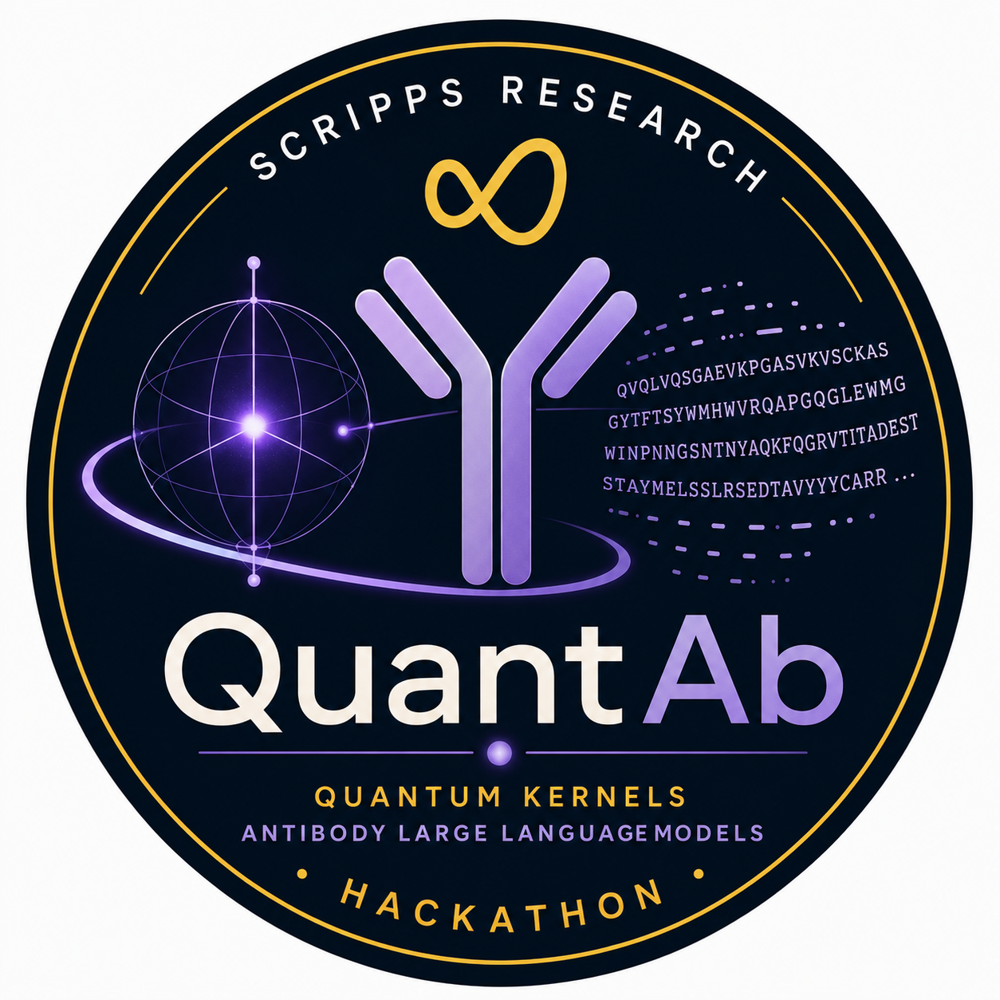

<p align="center">
  
</p>

# QuantAb

**Quantum kernel methods for antibody affinity prediction**

Can quantum kernels extract binding-relevant structure from antibody language model embeddings
that classical kernels miss — especially in the small-labeled-data regime typical of antibody
affinity prediction?

This project applies quantum machine learning to antibody-antigen affinity prediction. Antibody
sequences are encoded as embeddings via three language models — the antibody-specific
[IgBERT](https://huggingface.co/Exscientia/IgBert), the general protein model
[ESM-2](https://huggingface.co/facebook/esm2_t33_650M_UR50D), and the natively-paired
antibody model [BALM-paired](https://huggingface.co/brineylab/BALM-paired) (Burbach & Briney
2024) — then compressed to low dimensions via PCA, and evaluated using quantum kernel methods
versus classical baselines across a range of training set sizes (learning curves).

---

## Research question

> In the small-labeled-data regime characteristic of antibody affinity prediction, do quantum
> kernel methods operating on antibody language model embeddings capture binding-relevant
> structure that classical kernels miss?

A secondary question this project uniquely addresses:

> Does any quantum kernel advantage depend on the embedding model — antibody-specific (IgBERT),
> general protein (ESM-2), or natively-paired (BALM-paired)?

---

## Pipeline

```
Antibody sequences
      ↓
AbLM embeddings
  ├── IgBERT        (antibody-specific,  1024-dim, mean pooling)
  ├── ESM-2 650M    (general protein,   1280-dim, mean pooling)
  └── BALM-paired   (natively-paired,   1024-dim, mean pooling)
      ↓
PCA reduction  →  6 or 10 dimensions  (= qubit count)
      ↓
┌──────────────────────────┐    ┌─────────────────────────────────┐
│  Quantum kernel           │    │  Classical baseline             │
│  · Minimal ansatz        │    │  · MLP head                     │
│  · Expressive ansatz     │    │  · kernel comparator            │
│    (PennyLane circuits)  │    │                                 │
└──────────────────────────┘    └─────────────────────────────────┘
      ↓
Spearman ρ  vs.  training set size  →  learning curves
```

---

## Dataset

All models are benchmarked on one merged, normalized table — **`unified_affinity_v3.csv`**
(**114,300 antibody–antigen pairs, 357 antigens**, 0 missing, all paired). Each row = an antibody
(heavy + light) + an antigen sequence + a measured binding affinity. Built from the team's
affinity-sourcing corpus, cleaned + normalized by `scripts/build_corpus_dataset.py`; stored on S3.

| Source | System | Rows | Antigen |
|---|---|---|---|
| Phillips 2021 | CR9114 anti-influenza DMS | 67,033 | flu HA |
| Engelhart 2022 (AlphaSeq) | anti-VEGF campaign | 42,381 | VEGF |
| Dailey 2021 | CR9114 single-mutants | 3,699 | flu HA |
| ANDD 2026 | diverse SAbDab / PDB / sdAb | 702 | many |
| Shanehsazzadeh 2023 | trastuzumab | 421 | HER2 |
| MAGMA-seq 2022 | 4A8 / CC12.1 | 64 | SARS-CoV-2 |

- **Label:** `affinity` = pKd (−log10 KD); **`affinity_norm`** = pKd z-scored within each
  (method, antigen) group — the regression target. (Rows pool assays with different scales, so raw
  KD isn't comparable; per-group normalization makes one consistent target.)
- **Measured methods only** (predicted KDs dropped). **Coverage is uneven / 2-antigen-dominated**:
  Flu + VEGF ≈ 99% of rows, and 250 antigens are singletons.
- **Excluded** (not usable): PLAbDab (no labels), SARS2 escape (escape ≠ KD), IEDB epitopes
  (categorical), AB-Bind (ΔΔG), SKEMPI (no sequences).

Full details: [`data/README.md`](data/README.md) and [`results-classic.md`](results-classic.md).
S3: `s3://scrippsresearch-mshafiei-hackathon/curated_data/unified_affinity_v3.csv`

---

## Results

Binding-affinity regression from each model's mean-pooled embeddings on
`unified_affinity_v3.csv` (114,300 rows, 357 antigens). 5-fold cross-validation **holding out
whole antigens** (each model is scored on antigens it never saw in training).

| Model | Spearman ρ ↑ | Pearson r ↑ | R² ↑ | RMSE ↓ | Recall@10% ↑ |
|---|---|---|---|---|---|
| **IgBERT** | **0.31** | **0.26** | −0.39 | 1.12 | **0.14** |
| BALM-paired | 0.23 | 0.15 | −0.28 | 1.08 | 0.12 |
| ESM-2 650M | 0.16 | 0.12 | −0.35 | 1.12 | 0.12 |

- **Spearman ρ / Pearson r** — rank / linear correlation of predicted vs measured affinity.
- **R²** — fraction of variance explained (negative = worse than just predicting the mean).
- **RMSE** — error in normalized affinity units (lower is better).
- **Recall@10%** — share of the true strongest binders recovered in the model's top 10% (random ≈ 0.10).

**IgBERT (antibody-specific) is best on every metric.** Generalizing to *unseen antigens* is hard
here (all R² negative), so Spearman/Recall are the meaningful comparison. Adding the antigen
embedding doesn't help (data is Flu+VEGF-dominated).

**Inputs:** IgBERT and ESM-2 take VH+VL concatenated (no separator); BALM-paired takes them as a
native pair (`<s> VH </s></s> VL </s>`). All three are mean-pooled over residues.

Full dataset, model-input, and method details: **[results-classic.md](results-classic.md)**.

---

## Installation

```bash
git clone git@github.com:brineylab/QuantAb.git
cd QuantAb
pip install -r requirements.txt
pip install -e .
```

Verify the install:

```bash
python -c "import quantab; print('quantab ready')"
```

---

## Running the pipeline

### Step 1 — Extract embeddings

Run IgBERT and ESM-2 on all datasets and save embeddings to disk.
This is the slow step (~30 min on CPU for 109k sequences). It only needs to run once —
subsequent runs skip already-computed files.

```bash
python scripts/extract_embeddings.py --data-dir /path/to/DMS_Data
```

Options:
```
--data-dir      Path to the DMS_Data directory (required)
--output-dir    Where to save embeddings (default: embeddings/)
--model         igbert | esm2_35M | esm2_150M | esm2_650M | balm_paired | all  (default: all)
--n-components  PCA dimensions to compute, e.g. --n-components 6 10  (default: 6 10)
--overwrite     Force recompute even if files exist
```

Output structure:
```
embeddings/
  igbert/
    phillips_all_raw.npy      # raw 1024-dim  (N, 1024)
    phillips_all_6d.npy       # PCA-reduced   (N, 6)
    phillips_all_10d.npy      # PCA-reduced   (N, 10)
    phillips_all_labels.npy   # affinity y    (N,)
    engelhart_...npy
    ...
  esm2_650M/
    phillips_all_raw.npy      # raw 1280-dim
    ...
  balm_paired/
    phillips_all_raw.npy      # raw 1024-dim  (paired heavy+light)
    ...
```

### Step 2 — Run experiments

Two arms are evaluated separately as learning curves:

```bash
# Classical arm
python scripts/run_experiments.py --no-quantum

# Quantum arm (adds the quantum kernels)
python scripts/run_experiments.py
```

Results are written as JSON to `results/`.

---

## Repository structure

```
QuantAb/
├── quantab/               # Core Python package
│   ├── __init__.py        # Clean public API
│   ├── data.py            # DMS dataset loaders
│   ├── embeddings.py      # IgBERT, ESM-2, BALM-paired extraction, PCA, model registry
│   ├── quantum_kernels.py # PennyLane quantum kernel implementations
│   ├── classical.py       # sklearn classical baselines
│   ├── evaluation.py      # Learning curves, CV, Spearman metric
│   └── visualization.py   # Figure generation
├── scripts/
│   ├── extract_embeddings.py   # Step 1: sequences → cached embeddings
│   └── run_experiments.py      # Step 2: embeddings → learning curve results
├── notebooks/             # Exploration notebooks
├── figures/               # Generated figures (committed)
├── requirements.txt
├── pyproject.toml
├── PLAN.md                # Full experimental design
├── CLAUDE.md              # Claude Code collaboration guide
└── MEMORY.md              # Design decisions and discussion log
```

---

## References

- Leem J. et al. (2022). IgBERT: antibody language model. *Bioinformatics*.
- Lin Z. et al. (2023). Evolutionary-scale prediction of atomic level protein structure with a language model. *Science* **379**, 1123–1130.
- Burbach S.M. & Briney B. (2024). Improving antibody language models with native pairing. *Patterns*. https://doi.org/10.1016/j.patter.2024.100967
- Phillips A.M. et al. (2021). Binding affinity landscapes constrain the evolution of broadly neutralizing anti-influenza antibodies. *eLife*.

---

## Team

Briney Lab, Department of Immunology and Microbiology, The Scripps Research Institute

---

## License

TBD
